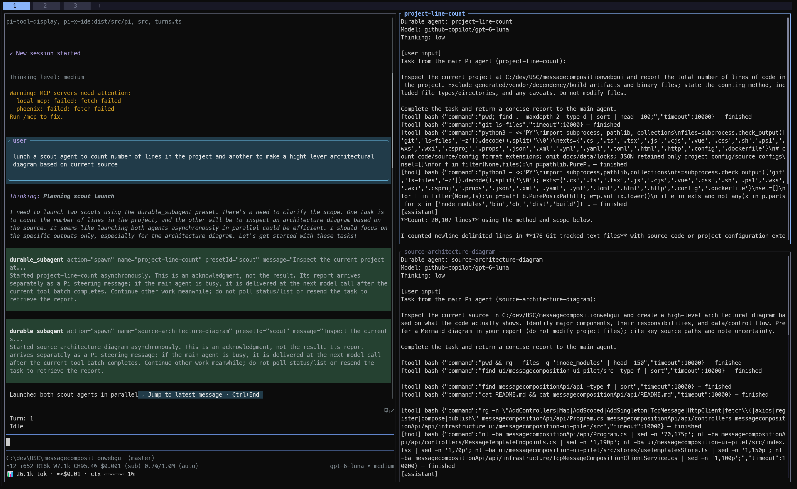
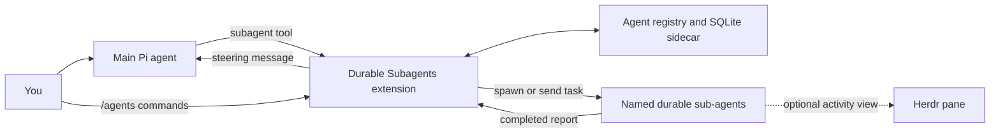

# Pi Durable Subagents

**Delegate work to background agents, keep working while they run, and return to the same named agents for follow-up tasks.**

Pi Durable Subagents is a Pi extension for managing named, reusable agents backed by `@earendil-works/pi-durable`. Spawn agents through Pi's `subagent` tool or control them directly with `/agents`.

<p align="center">
  
</p>
<p align="center"><em>Delegate from the main Pi conversation, keep working, and receive the agent's report back in the conversation. The right-hand pane shows the child agent at work.</em></p>

## Why use it?

- **Delegate and keep going.** Spawn work asynchronously; the agent reports back to the main Pi conversation when it finishes.
- **Reuse named agents.** Each agent keeps its own durable conversation. Send follow-up work to the same agent, including after resuming the Pi session.
- **Choose how to work.** Ask Pi to delegate through the `subagent` tool, or manage agents yourself with `/agents`.
- **See what's happening.** Track active work, requests, usage, and costs in the Pi footer and with agent status commands.
- **Configure agents with presets.** Set an agent's tool allowlist, model, and thinking level.
- **Optionally use live Herdr panes.** In a Herdr-managed terminal, a bounded pool of panes shows agent activity without limiting how many agents can work.

## How it works

The `subagent` tool and `/agents` commands use the same extension service and agent registry. Child agents have their own durable conversations. Their reports return to the main Pi agent as steering messages; if Pi is busy, a report is delivered after the current tool batch.



The main-agent/sub-agent communication design was inspired by [Pi's background subagent example](https://github.com/earendil-works/pi/blob/main/packages/durable/test/examples/22-subagent-background.ts).

## Install

Install from npm:

```sh
pi install npm:pi-durable-subagents-extension
```

Or install directly from GitHub:

```sh
pi install git:github.com/ghita/durable-subagents-pi-extension
```

For local development, load the extension directly:

```sh
pi --extension ./src/index.ts
```

## Requirements

- Pi `1.5.2` or compatible.
- A persisted Pi session transcript. Temporary or transcript-less sessions cannot use durable agents.
- A model available through Pi's `ModelRegistry` and configured provider authentication. The extension reuses Pi's model registry; it does not ask for or store a second credential.

## Quick start

Ask Pi to delegate a task in natural language, for example:

> Start a named agent called `researcher` and ask it to compare the main approaches in this project. Continue with my other request while it works, then summarize its report when it arrives.

Or spawn and manage an agent directly:

```text
/agents spawn researcher -- Compare the main approaches in this project and report the tradeoffs.
/agents list
/agents send researcher Check whether the project has tests for those approaches.
/agents status researcher
```

The `subagent` tool supports `spawn`, `send`, `list`, `status`, `stop`, `stop-all`, and `stats`. It shares the same registry, presets, history, and service as `/agents`.

## Commands

```text
/agents help
/agents presets
/agents list
/agents status <name>
/agents spawn <name> [--preset <preset-id>] -- <task>
/agents send <name> <message>
/agents stop <name>
/agents stop --all
/agents stats
/agents footer alwaysOn|activity
/agents panes
/agents panes <K>
```

Names containing spaces can be quoted. If a spawn name matches a preset ID, that preset is used by default; `--preset` can select a different preset while retaining the chosen instance name. A missing preset is an unconfigured, all-tools agent. Name collisions—including with idle agents—receive a numeric suffix. Agents remain registered after completing or stopping work, and later `send` operations reuse their conversation. A send to busy work is steered into the existing agent. `stop --all` affects managed work only, never the main Pi agent.

## Features in detail

### Durable conversations and reports

Each managed agent is stored in a SQLite sidecar beside its Pi transcript, named `<transcript-base>.durable.sqlite`. Resuming that transcript reopens its agents, work, and pending reports. A deleted Pi transcript can leave an orphan sidecar; automatic cleanup is intentionally not implemented.

Reports are extension-authored custom steering messages, not user commands. When Pi is busy, a report is queued for the next model call after the current tool batch; when Pi is idle, it triggers a turn immediately. Steering can redirect the main agent's current task, but does not interrupt a tool already running. Each report includes a stable ID; the extension acknowledges it only after the entry is visible in Pi's session. Pi's transcript and the Durable sidecar cannot be committed atomically, so a crash or storage divergence at that boundary can still produce at-least-once delivery. Message counters are stored with the managed-agent registry and updated idempotently around stable report/request IDs.

Status and stats read Durable usage records for managed child conversations only. The main Pi conversation is excluded. Usage cost uses the best available provider-reported or model-catalog value, so aggregate costs may mix those sources.

### Presets

Presets are user-global Markdown files discovered recursively under:

```text
<Pi configured agent directory>/agents/**/*.md
```

The base directory comes from Pi's `getAgentDir()` configuration. A file defines a preset only when its YAML frontmatter contains `name`; Markdown without `name` is ignored and can be used as supporting documentation. The frontmatter `name`, not the filename or folder, is the preset ID and must be unique. For example:

```md
---
name: researcher
description: Research a topic and return a concise, sourced report.
tools: [read, bash]
model: inherit
effort: high
---

Search the project and return a concise summary with file references.
```

`name`, `description`, `model`, and `effort` are required. `model` accepts `inherit` or `provider/model-id`; explicit references must resolve through Pi's model registry and configured provider authentication. `effort` accepts `inherit` or `off`, `minimal`, `low`, `medium`, `high`, `xhigh`, or `max` (mapped to Pi's thinking level). Inherited model and effort follow later parent changes; explicit values remain fixed for existing agents.

`tools` is optional and Pi-specific. Supported durable-native tools are `read`, `write`, `edit`, and `bash`; an explicit non-empty list is an exact allowlist. If omitted, all four tools are available. Claude Code tool names and Claude-only settings are not supported. Unknown frontmatter fields, malformed definitions, duplicate IDs, invalid settings, and empty instruction bodies are reported as preset errors and never silently broaden tool access or substitute another model. The `/agents presets` listing includes each description and its available tools; the main agent receives the descriptions to help it select a useful preset.

Preset files are read and cached when the extension loads. Changes apply to new agents after Pi `/reload`; they do not rewrite existing agents. See [the agent preset file guide](docs/agents/agent-files.md) for the complete schema and portability caveats.

### Running-agent footer

By default, in Pi's interactive TUI, the footer temporarily shows a moving spinner and a stacked status block for every running managed agent. Each block includes the agent name, its state (`queued`, `running`, or `idle`), short model ID and thinking level, cumulative assistant turns and executed tool uses, cumulative message in/out counts and cost, an estimated context-token count, and a one-line preview of its latest request. `[fresh]` appears only for an agent's first task. Idle and completed agents are omitted, and the built-in footer returns when no managed agent is running.

Use `/agents footer alwaysOn` to keep the custom footer visible and show managed-agent summaries even after they become idle. `/agents footer activity` restores the default behavior, showing only active agents and keeping the footer for the three-second hide delay. This setting lasts for the current Pi extension process.

The display refreshes about once a second while agents are running. Context usage is a proxy from the latest model-reported input usage and may lag until the agent's next model response. On short terminals, task previews are hidden before agent status lines. The extension recreates the normal cwd, usage, model, and extension-status footer lines while its custom multi-line footer is active.

### Herdr live agent panes

When the extension runs in a Herdr-managed pane, it automatically shares a bounded pool of non-focused agent-display panes in the current tab. **The default budget is 3 panes.** This limits displays, not agents: overflow agents keep executing and reporting normally, without creating overflow tabs. The main Pi pane and unrelated terminals do not count toward the budget.

Use `/agents panes` to report the current budget and `/agents panes K` to set a nonnegative integer budget immediately. `/agents panes 0` removes owned displays without stopping agents or deleting their durable conversations. Increasing the budget admits waiting active agents immediately. Shrinking removes idle displays first, then the most recently assigned active displays; displaced agents keep their original waiting priority. The preference is runtime-only: it survives managed-session runtime recreation in the same extension instance, but resets to 3 on extension reload or Pi restart. Different Herdr tabs have independent budgets. **Only one display-managing main Pi session per Herdr tab is supported**; multiple managers sharing a tab are not coordinated.

Displayed active agents retain their slots. Waiting active agents are admitted in arrival order, skipping agents that become idle before admission. An agent is eligible while it has executing or queued instructions; pending report delivery alone does not count. An idle pane retains its last output until another active agent needs the slot, with the longest-idle pane reused first. An undisplayed agent receiving more work joins the back of the queue, regardless of earlier pane ownership. There are no manual selection or pinning commands.

Reassignment reuses the pane, clears both the screen and scrollback, shows the new agent's identity (name, model, and thinking level), and replays its current-task output before live updates continue. The old agent's history remains in its durable conversation, not in the reused display. Panes show user inputs, assistant text (not hidden thinking), and completed tool calls with compact arguments and success/failure status; tool results are not copied. A private local renderer socket avoids echoing bootstrap commands for every update.

On resume/reload, tracked owned panes are reconciled to the budget, retaining eligible active displays first and idle displays only in spare slots. Excess legacy displays are closed without touching unrelated terminals or deleting agent state. Manually closing a display does not reduce the budget: active demand can recreate it, checked about once a second. Use `/agents panes K` to reduce the footprint instead. Panes are explicitly targeted without stealing focus.

The integration is enabled only when `HERDR_ENV=1` and `HERDR_WORKSPACE_ID` are present and the `herdr` CLI is available. Display failures never stop agent work. Failed or uncertain pane operations are conservatively accounted for rather than risking extra replacements beyond the budget. A split is durably reserved before invoking Herdr; an unresolved split outcome suspends new pane creation even across reloads, until the reservation is explicitly resolved after inspection. There is no automatic reset on restart. Known-pane reconciliation can still retry, and a confirmed failure to start the CLI does not leave a reservation. Failures produce rate-limited visible warnings (at most one per 30 seconds), rather than notification flooding.

### Opt-in OpenTelemetry

Telemetry export is disabled unless `DURABLE_SUBAGENTS_OTLP_ENDPOINT` is set. The value is the OTLP collector base endpoint (for example, `http://localhost:4318`); HTTP/protobuf is the default transport and the extension sends traces to `/v1/traces` and metrics to `/v1/metrics`. Set `OTEL_EXPORTER_OTLP_PROTOCOL=grpc` for an OTLP/gRPC collector. Standard OpenTelemetry headers, signal-specific endpoints, timeouts, resource attributes, and metric export interval settings are also honored. For example:

```powershell
$env:DURABLE_SUBAGENTS_OTLP_ENDPOINT = "http://localhost:4318"
$env:OTEL_EXPORTER_OTLP_HEADERS = "Authorization=Bearer%20collector-token"
pi
```

```sh
DURABLE_SUBAGENTS_OTLP_ENDPOINT=http://localhost:4318 \
OTEL_EXPORTER_OTLP_HEADERS='Authorization=Bearer%20collector-token' pi
```

When enabled, traces cover managed-agent requests through child model/tool activity and report delivery. Task text, assistant responses, tool-call arguments, and tool outputs are included (each field is capped at 64 KiB with truncation metadata); hidden reasoning is excluded, and credential-like keys in tool arguments are redacted. Free-form task and tool content may still contain sensitive data, so configure a trusted collector and review its access and retention policies. Telemetry setup/export failures are fail-open: agent work continues and telemetry may be lost. The extension does not write operational details or task content to a plain-text log. See the [full telemetry guide](docs/telemetry.md) for HTTP/protobuf and gRPC setup, configuration, and troubleshooting.

## Safety and scope

“Read-only” is only an agent prompt instruction. The durable `bash` tool can modify files; it is not a security boundary. V1 does not copy Pi tool implementations into child agents, expose recursive subagent management inside children, or monitor transcript deletion.

## Development

Run the offline checks with:

```sh
npm test
npm run typecheck
```

The optional `npm run test:model-bridge` makes a real model request through Pi's configured provider authentication and is not part of the offline test suite. It uses Pi's configured default model, or you can set `PI_DURABLE_MODEL=provider/model` to choose one.
